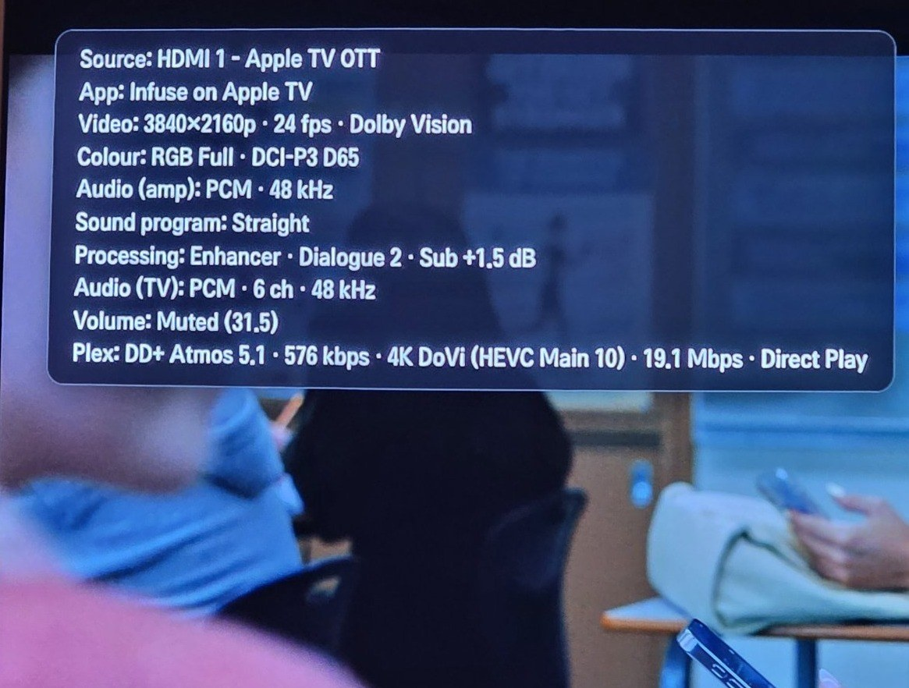
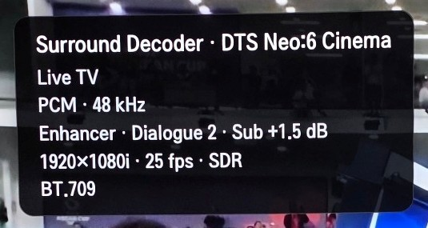
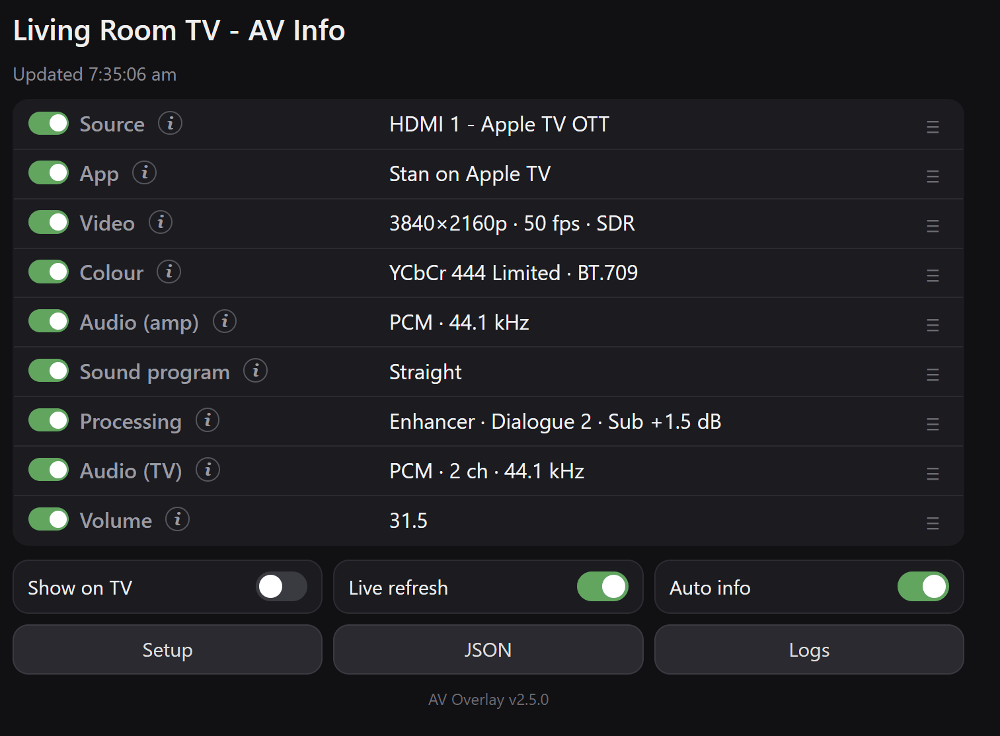
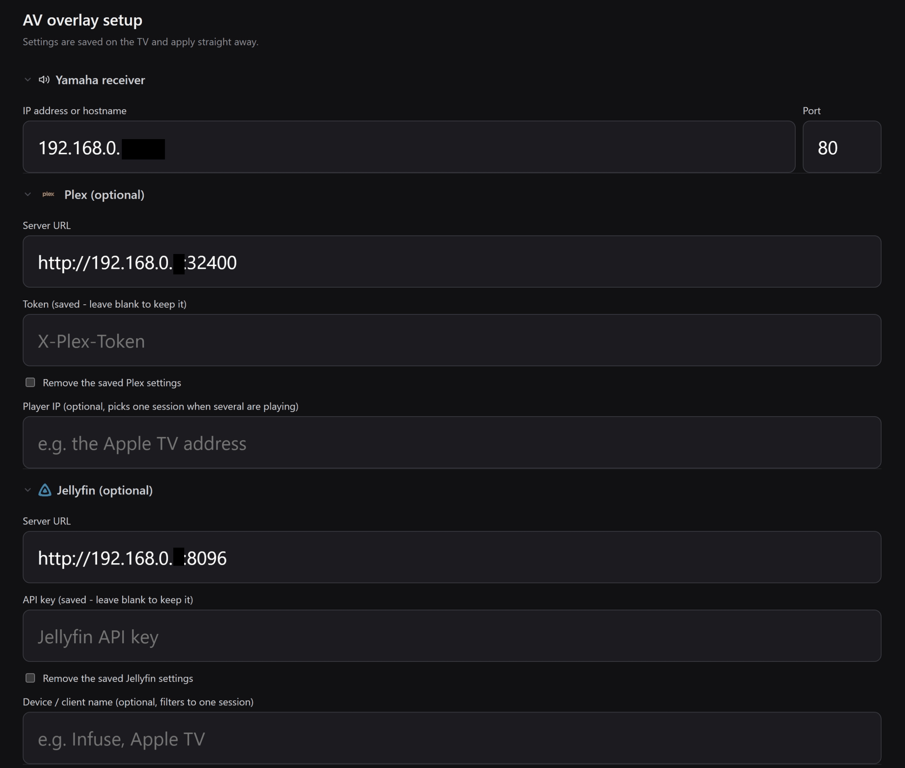
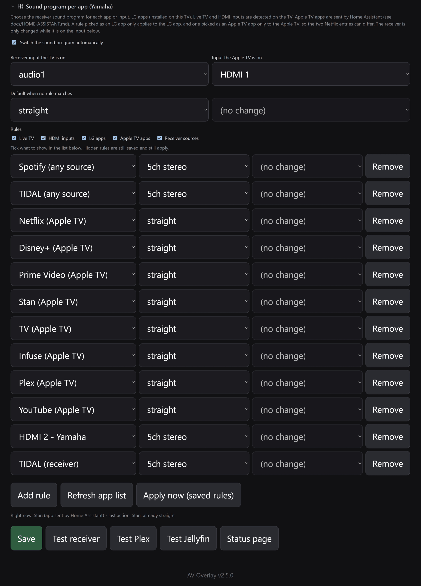
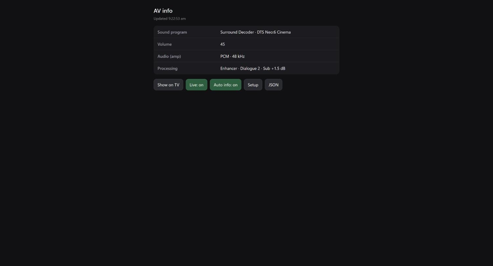
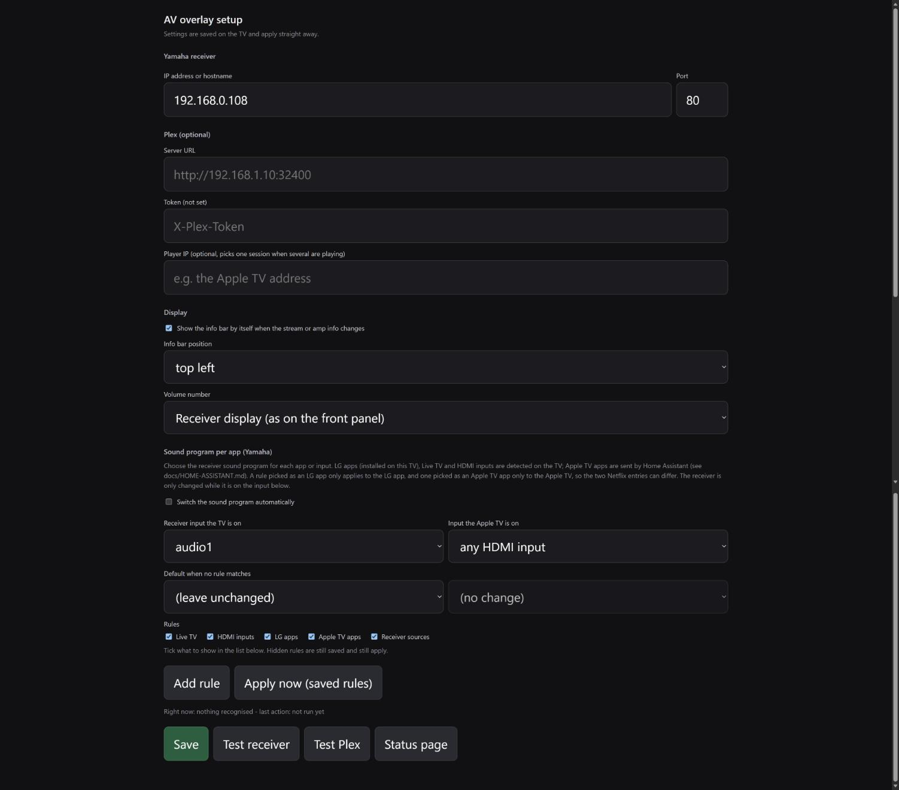

# AV Overlay for LG webOS and Yamaha Receivers

[](https://github.com/SammySco/webos-av-overlay/actions/workflows/build.yml)
[](https://github.com/SammySco/webos-av-overlay/releases/latest)
[](LICENSE)


**On-screen volume, audio/video format info bar and per-app sound programs for rooted LG webOS TVs
(eARC) paired with a Yamaha MusicCast / RX-V receiver.** Optional Plex and Jellyfin stream details,
Home Assistant automation hooks, an Android status app, and a Docker deployment option.
Tested on an RX-V485 over eARC. It is a fork of
[Nikolay1243/Webos-EARC-Volume-Overlay](https://github.com/Nikolay1243/Webos-EARC-Volume-Overlay),
which showed a numeric volume; this version reads the receiver directly and adds an info bar.

**Why this exists:** with an LG TV sending audio to a receiver over eARC, the receiver owns the volume
and does the decoding, and webOS gives you little on-screen feedback about either. This overlay shows
the receiver's volume and mute state, the sound program, the audio format actually reaching the amp
(Dolby Atmos, DTS, PCM and so on), and the video format and HDR in use, without leaving the TV.

<table>
  <tr>
    <td align="center" valign="top">
      <br>
      <sub>The info bar over Dolby Vision from an Apple TV app: sound program, input, detected app, audio, Plex stream (direct play), amp processing, video and colour.</sub>
    </td>
    <td align="center" valign="top">
      <br>
      <sub>On Live TV the bar shows the surround decoder, the PCM audio the receiver gets, and the broadcast video format.</sub>
    </td>
  </tr>
</table>

<table>
  <tr>
    <td align="center" valign="top" width="50%">
      <br>
      <sub>The status page (<code>/status</code>): current values, Show/Hide on TV, a live view and the Auto info switch.</sub>
    </td>
    <td align="center" valign="top" width="50%">
      <br>
      <sub>The setup page (<code>/setup</code>): receiver address, optional Plex and Jellyfin, info bar settings, and per-app sound programs. Sections are collapsible.</sub>
    </td>
  </tr>
</table>

<br>
<sub>Per-app sound programs on the setup page: a default, then one rule per input, LG app or Apple TV app, with tick boxes to show or hide each group.</sub>

- **Volume popup** (bottom-right) whenever the receiver's volume or mute changes, including half steps.
- **Info bar** with the sound program, volume, source, audio format, Plex or Jellyfin stream details (optional),
  amp processing, video format/HDR and colour. Every line starts with its name ("Video: ..."). It appears when
  something changes (switchable), on demand, or pinned on screen. A volume change only shows the volume popup; the
  bar's Volume line is updated in place while the bar is up.
- **Audio (TV)** (optional, off by default): what the TV itself sees on its input, with or without a receiver. On an
  HDMI input it shows the codec, channel count and sample rate (for example `PCM · 8 ch · 48 kHz`); on Live TV and
  LG apps it shows the codec. See [Using it without a Yamaha receiver](#using-it-without-a-yamaha-receiver).
- **Choose and order the rows.** On the status page each row has an on/off switch and a drag handle: switch a row
  off to hide it from the TV bar, drag it to move it. The setup page has the same list of rows.
- **Status page** at `http://<tv>:41101/status` with toggle switches for Show on TV, live view, and Auto info.
- **Setup page** at `http://<tv>:41101/setup`, also opened by the **AV Overlay Settings** icon on the TV home screen.
- **Sound program per app**: pick the receiver's sound program for Live TV, each HDMI input, webOS apps (Netflix,
  YouTube, ...), Plex players and, with a small Home Assistant automation, each Apple TV app. See
  [docs/HOME-ASSISTANT.md](docs/HOME-ASSISTANT.md).
- Endpoints for automation: `/info`, `/status.json`, `/tv/show`, `/tv/hide`, `/app?name=...`.

## Compatibility

**Confirmed:** an LG OLED65C2PSC (C2, 2022 OLED) on webOS 11.2.0 with a Yamaha RX-V485 over eARC (Extended Control
API 2.17). Everything else below is **expected**, not tested. Other receiver brands are not supported.

You need a **rooted LG webOS TV on webOS 4.0 or newer** (2018 models onwards) and a **Yamaha network receiver** that
offers the Extended Control API (RX-V, RX-A, RX-S, MusicCast). The full per-model lists, a two-line check for your
receiver and notes on which LG firmware can be rooted are in **[docs/COMPATIBILITY.md](docs/COMPATIBILITY.md)**.

<table>
  <thead>
    <tr>
      <th align="left">Model Year</th>
      <th align="left">Series</th>
      <th align="left">Models</th>
      <th align="left">Status</th>
    </tr>
  </thead>
  <tbody>
    <tr>
      <th colspan="4" align="left">Yamaha receivers</th>
    </tr>
    <tr>
      <td>2024 onwards</td>
      <td>RX-300</td>
      <td>Yamaha RX-300A</td>
      <td>Expected to work (no volume-scale sync)</td>
    </tr>
    <tr>
      <td>2021 onwards</td>
      <td>Aventage "A"</td>
      <td>Yamaha RX-A2A, RX-A4A, RX-A6A, RX-A8A</td>
      <td>Expected to work (no volume-scale sync)</td>
    </tr>
    <tr>
      <td>2020 onwards</td>
      <td>RX-V "A"</td>
      <td>Yamaha RX-V4A, RX-V6A</td>
      <td>Expected to work (no volume-scale sync)</td>
    </tr>
    <tr>
      <td>2018-2019</td>
      <td>RX-V "85"</td>
      <td>Yamaha RX-V485 (<b>confirmed</b>), RX-V585, RX-V685, RX-V785</td>
      <td>Expected to work</td>
    </tr>
    <tr>
      <td>2017</td>
      <td>RX-V "83"</td>
      <td>Yamaha RX-V483, RX-V583, RX-V683</td>
      <td>Expected to work</td>
    </tr>
    <tr>
      <td>2016</td>
      <td>RX-V "81"</td>
      <td>Yamaha RX-V481, RX-V581, RX-V681, RX-V781</td>
      <td>Expected to work</td>
    </tr>
    <tr>
      <td>2015-2019</td>
      <td>Aventage RX-A</td>
      <td>Yamaha RX-A750 to RX-A3080</td>
      <td>Expected to work</td>
    </tr>
    <tr>
      <td>2015-2018</td>
      <td>Slimline RX-S</td>
      <td>Yamaha RX-S601, RX-S602</td>
      <td>Expected to work</td>
    </tr>
    <tr>
      <td>2016-2019</td>
      <td>RX-V "80" entry</td>
      <td>Yamaha RX-V381, RX-V383, RX-V385</td>
      <td>Not supported (no network control)</td>
    </tr>
    <tr>
      <th colspan="4" align="left">LG TVs</th>
    </tr>
    <tr>
      <td>2025</td>
      <td>OLED</td>
      <td>LG B5, C5, G5</td>
      <td>Unknown, check first</td>
    </tr>
    <tr>
      <td>2024</td>
      <td>OLED</td>
      <td>LG B4, C4, G4, M4, Z4</td>
      <td>Unlikely (webOS 9 reported patched)</td>
    </tr>
    <tr>
      <td>2023</td>
      <td>OLED</td>
      <td>LG B3, C3, G3, Z3</td>
      <td>Unknown, check first</td>
    </tr>
    <tr>
      <td>2022</td>
      <td>OLED</td>
      <td>LG A2, B2, C2 (OLED65C2PSC), G2, Z2</td>
      <td>Depends on firmware (C2 <b>confirmed</b>)</td>
    </tr>
    <tr>
      <td>2021</td>
      <td>OLED</td>
      <td>LG A1, B1, C1, G1, Z1</td>
      <td>Depends on firmware</td>
    </tr>
    <tr>
      <td>2020</td>
      <td>OLED</td>
      <td>LG BX, CX, GX, WX, ZX</td>
      <td>Depends on firmware</td>
    </tr>
    <tr>
      <td>2019</td>
      <td>OLED</td>
      <td>LG B9, C9, E9, W9</td>
      <td>Expected to work once rooted</td>
    </tr>
    <tr>
      <td>2018</td>
      <td>OLED</td>
      <td>LG B8, C8, E8, G8, W8</td>
      <td>Expected to work once rooted</td>
    </tr>
    <tr>
      <td>2017 and earlier</td>
      <td>All lines</td>
      <td>All LG webOS TVs</td>
      <td>Not supported (below webOS 4.0)</td>
    </tr>
  </tbody>
</table>

"Expected" means reported to offer the right APIs or rootability; it has not been tested with this overlay. Rooting
depends on the exact firmware: check your TV at [CanI.RootMy.TV](https://cani.rootmy.tv) first.

Using a different TV model, webOS version or Yamaha receiver? Please open a
[compatibility report](https://github.com/SammySco/webos-av-overlay/issues/new?template=compatibility_report.yml)
so the table can list what is known to work.

## FAQ

**My Yamaha receiver's volume doesn't show on my LG TV over eARC. Can this help?**
It can show the volume another way. Some owners report that the receiver's own on-screen volume
(the "Short Message" setting) doesn't appear on LG TVs, particularly with Dolby Vision or high-bandwidth
video. This project does not change that. It reads the volume and mute state from the receiver over the
network and draws its own popup on the TV, including half-steps. It is worth checking the receiver's
Short Message setting first.

**Can I see whether Dolby Atmos, DTS or PCM is reaching my receiver?**
Yes. The info bar shows the audio format, sample rate and bit depth the receiver reports, plus the sound
program and decoder. Boxes that decode audio themselves, such as an Apple TV, send PCM, so the bar shows
PCM. The receiver does not report a channel count. The optional "Audio (TV)" row (switch it on in Setup) shows what
the TV itself sees on its input; on HDMI that includes a channel count, but it counts the HDMI link's channels (an
Apple TV sends 5.1 as 8), and on Live TV and LG apps it shows only the codec. The optional Plex integration can show the
codec and channels of the stream itself.

**Does it work with other TVs or other receiver brands?**
It needs a rooted LG webOS TV. The volume popup, the receiver's audio and processing lines and the per-app sound
programs need a Yamaha receiver with the Extended Control API; other brands are not supported for those. Other
Yamaha network receivers are expected to work (see [docs/COMPATIBILITY.md](docs/COMPATIBILITY.md)), and compatibility
reports are welcome. The TV-side lines of the info bar do not depend on the receiver at all: see the next question.

**Can I use it without a Yamaha receiver?**
Partly. Leave the receiver address empty and the info bar shows what the TV, Plex and Jellyfin know: Source, App,
Audio (TV), Plex or Jellyfin, Video and Colour. There is no volume popup, sound program or receiver audio line.
Details, and how to set it up, are in [Using it without a Yamaha receiver](#using-it-without-a-yamaha-receiver).

**Do I have to root my TV?**
Yes. The watcher runs on the TV as root and needs SSH access. A Docker deployment can run the watcher on a
home server instead, but the apps still have to be installed on a rooted TV.

**Can it change the receiver's sound program per app?**
Yes. Set a default and a rule per input, LG app or Apple TV app, on the `/setup` page.

## Requirements

- An LG TV that is **rooted** with the [Homebrew Channel](https://www.webosbrew.org/) installed.
  Rooting is not covered here and can void your warranty. Firmware updates can remove root.
- **SSH access to the TV as root**, ideally with a key.
- A **Yamaha receiver with the Extended Control API** (most MusicCast and recent RX-V models), on the same LAN.
  Other brands are not supported, but a receiver is optional if you only want the TV-side info bar (see
  [Using it without a Yamaha receiver](#using-it-without-a-yamaha-receiver)).
- Optional: a **Plex** server and its token, or a **Jellyfin** server and an API key, for stream details.

## Deployment options

There are two ways to run the watcher process. The TV apps (the visual overlay and the settings launcher) are
installed the same way in both cases.

### Option A — on the TV (default)

The watcher runs directly on the rooted TV as a background service. Nothing extra is needed.

**Requirements:** Node.js 18+, `ssh`/`scp`, and a POSIX shell (macOS, Linux, or Git Bash/WSL on Windows).

See [docs/INSTALL.md](docs/INSTALL.md) for the full guide, from rooting the TV to Home Assistant.

```sh
git clone https://github.com/SammySco/webos-av-overlay
cd webos-av-overlay
TV_HOST=root@TV_IP sh scripts/install.sh
```

**On Windows**, unpack the release archive and double-click `Install-AVOverlay.cmd` (no Git Bash or Node needed,
only the built-in OpenSSH Client), or run `scripts\install.ps1`; it asks the same questions.

### Option B — in Docker (on a home server or Raspberry Pi)

The watcher runs in a Docker container on a separate Linux host on the same LAN. The TV apps are still installed
on the TV; only the background process moves off the TV. This keeps the TV free of the Node.js runtime and makes
updates easier.

**Requirements:** a Linux host on the same LAN, Docker Engine, and an SSH key that can reach the TV.
For instant amp volume events `network_mode: host` is used — this works on Linux Docker Engine but not on
Docker Desktop (Mac/Windows).

A prebuilt image is published to the GitHub Container Registry on each tagged release:
`ghcr.io/sammysco/webos-av-overlay`. Use it in `docker-compose.yml` by replacing `build: .` with
`image: ghcr.io/sammysco/webos-av-overlay:latest`.

See [docs/DOCKER.md](docs/DOCKER.md) for the full guide.

```sh
git clone https://github.com/SammySco/webos-av-overlay
cd webos-av-overlay
sh scripts/docker/install.sh   # checks prerequisites, configures, and starts the container
```

<table>
  <tr>
    <td align="center" valign="top" width="50%">
      <br>
      <sub>The status page at <code>http://&lt;docker-host&gt;:41101/status</code>: current receiver state, Show/Hide on TV, and controls.</sub>
    </td>
    <td align="center" valign="top" width="50%">
      <br>
      <sub>The setup page at <code>http://&lt;docker-host&gt;:41101/setup</code>: receiver address, Plex, display and sound-program rules.</sub>
    </td>
  </tr>
</table>

---

The installer builds two packages (the overlay and the **AV Overlay Settings** launcher app), installs them,
asks a few questions, and starts the service:

| Question | Notes |
|---|---|
| Yamaha receiver IP/hostname | Checked from the TV; needed for the volume popup, receiver lines and sound programs. Without one, install with `EARC_NONINTERACTIVE=1` (see below) |
| Plex server URL, token, player IP | Optional. The token prompt is hidden and the token is only sent over SSH |
| Auto info on/off | Show the info bar by itself when something changes |
| Info bar position | top-left, top-center, top-right, middle-left, middle-right, bottom-left, bottom-center or bottom-right |

Jellyfin is not asked by the installer — configure it at `/setup` after installation.

Every answer can be supplied as an environment variable instead, and `EARC_NONINTERACTIVE=1` skips all questions.
Settings are stored on the TV in `/home/root/.earc-overlay.json` (readable by root only) and can be changed any
time at `/setup` or from the TV home screen.

The setup and status pages have no password and are meant for your home network only.

## Change settings later

Open **AV Overlay Settings** on the TV home screen, or browse to `http://<tv>:41101/setup`. Changes apply immediately.

## Choose and order the info bar rows

The status page (`http://<tv>:41101/status`) lists the current value of every row. The switch beside a row's name
turns that row on or off for the bar on the TV, and the handle (≡) on the right lets you drag it up or down; the
order you choose is the order on the TV. Rows with no value right now (Plex when nothing is playing, for example) are
not listed on the status page; the **Rows shown on the info bar** list at `/setup` has every row and the same
switches. The choices are saved on the TV (`hiddenRows` and `rowOrder` in `/home/root/.earc-overlay.json`). Rows: Sound program, Volume, Source, App, Audio (amp),
Audio (TV), Plex, Jellyfin, Processing, Video, Colour.

## Using it without a Yamaha receiver

The receiver is only needed for the volume popup, the sound program, the **Audio (amp)** and **Processing** lines and
the per-app sound-program rules. Everything the TV itself can tell you works with any receiver, or none:

| Row | Shown without a receiver |
|---|---|
| Source | Yes (the TV's input name, or "Live TV", or "LG TV apps" while an app on the TV is playing) |
| App | Yes (the LG app, or the Apple TV app if you use the Home Assistant automation) |
| **Audio (TV)** | Yes, once you switch it on (below) |
| Plex or Jellyfin | Yes, if configured |
| Video, Colour | Yes |
| Sound program, Volume, Audio (amp), Processing | No (these come from the receiver) |

**To set it up**
1. Install without a receiver address: `EARC_NONINTERACTIVE=1 TV_HOST=root@<tv-ip> sh scripts/install.sh` (on
   Windows, `scripts\install.ps1 -TvHost root@<tv-ip> -NonInteractive`). The interactive installer insists on a receiver, so skip its questions. If you
   already installed with a receiver, clear the **Yamaha receiver** address at `/setup` and save.
2. Open `http://<tv>:41101/setup`, tick **Show "Audio (TV)"** under Display, and save. It is off by default.
3. Press **Show on TV** on the status page. With no receiver address set the bar has no "Receiver not responding"
   title; it simply shows the TV's rows.

**What Audio (TV) shows**
- On an **HDMI input**: the codec, channel count and sample rate of the incoming signal, read from the same data as the
  TV's hidden "HDMI status" screen, for example `PCM · 2 ch · 44.1 kHz`. Boxes that decode audio themselves, such as an
  Apple TV, send PCM. The channel count is the HDMI link's, not the film's: an Apple TV sends 5.1 as 8 channels, so 5.1 and 7.1 look
  the same, while stereo shows as 2.
- On **Live TV and LG apps** (Netflix and others running on the TV): only the codec the TV decodes, for example
  `Dolby Digital Plus`. The TV does not report channels there.
- It does not need the receiver to be on, or to exist.

**Limits**
- Tested on an LG C2 (webOS 11.2) with a Yamaha receiver: the Audio (TV) readings above, on an Apple TV over HDMI, on
  Live TV and in native Netflix. The receiver-free layout of the bar is tested in code only; it has not yet been run
  on a TV with no receiver at all. Reports are welcome.
- Other LG models and webOS versions may name these TV services differently; if Audio (TV) stays empty, check the log
  (`/tmp/earc-volume-overlay.log`) and open an issue with your TV model and webOS version.
- There is still no receiver-side information: without a receiver you cannot see what reaches it after the TV.

## Android companion app

An Android app wraps the status page in a full-screen WebView so you can check the current state and control
the overlay from your phone. The app title updates to match the TV's device name (e.g. *Living Room TV - AV Info*).

Download **AV-Overlay-status.apk** from the [latest release](https://github.com/SammySco/webos-av-overlay/releases/latest),
install it (allow installs from unknown sources), and enter your TV's IP address when prompted.
It requires Android 7.0 or later and your phone to be on the same Wi-Fi as the TV.

## Uninstall

```sh
TV_HOST=root@TV_IP sh scripts/uninstall.sh          # keeps your settings
TV_HOST=root@TV_IP sh scripts/uninstall.sh --purge  # also deletes them
```

You can also remove the app from the Homebrew Channel. webOS has no uninstall hook, so the watcher notices that its
app folder has gone (it checks every 30 seconds and acts after about 90 seconds, so upgrades are not mistaken for a
removal), then removes its boot hook, pid files and state folder and exits. Your settings files
(`/home/root/.earc-overlay.json`, and `.earc-plex.json` if you use Plex, which holds a token) are kept so a reinstall
picks up where you left off; delete them with `scripts/uninstall.sh --purge`. This cleanup does not run in Docker.

## Troubleshooting

On the TV, `tail -f /tmp/earc-volume-overlay.log`. A healthy start looks like:

```text
service starting (yamaha 192.168.1.50, with signal info)
watching 192.168.1.50 at 42:false
```

- *"amp not configured"*: enter the receiver address at `/setup`, or ignore it if you are using the
  [TV-only info bar](#using-it-without-a-yamaha-receiver) on purpose.
- *"amp unreachable"*: check the address, that the receiver is on, and that "Network Standby" is enabled on it.
  While the receiver is not answering, the bar and the `/status` and `/info` pages say **"Receiver not responding"** with
  when it last answered, and the receiver's own numbers (volume, sound program, audio) are withheld instead of showing
  the last value; `/status.json` has `reachable` and `lastOk`. The volume popup simply does not appear.
- Remote channel up/down while the info bar is on screen: the first key press dismisses the bar and is
  passed on to Live TV, so one press still changes the channel.

## How it works

A root-side Node.js watcher on the TV subscribes to the receiver's events (with a poll as a fallback) and to the
TV's video output, foreground app and running-app state (luna subscriptions, not polling), and optionally reads Plex or
Jellyfin. It launches a transparent web app to draw the volume popup and the
info bar, and serves the status and setup pages on port 41101. The app closes itself when nothing is showing,
because an open overlay window takes the remote's key focus.

## Development disclosure

The original project was developed with substantial assistance from OpenAI Codex. This fork's additions were
developed with Claude Code, with testing on a real rooted LG webOS TV and a Yamaha RX-V485 by the maintainer.

## Safety

This is unofficial software for rooted TVs. Firmware updates can change private webOS services or remove root
access. Keep a known recovery path for your TV and review scripts before running them.

## Licence

MIT
